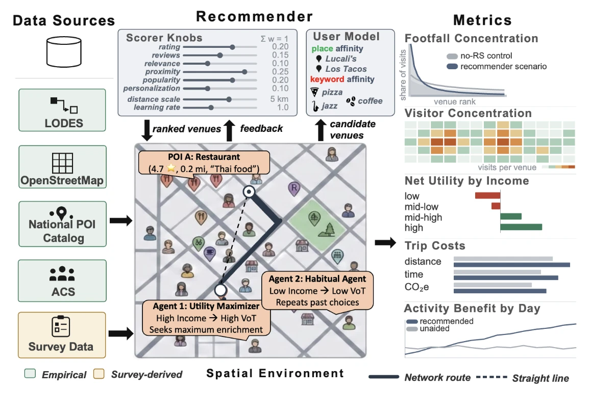

<h1 align="center">GeoRecSim</h1>

<p align="center">
  A city-scale simulation of how recommendation apps shape urban mobility.
</p>

<p align="center">
  <a href="https://airecsim.cusp.nyu.edu/"></a>
</p>

<p align="center">
  
  
  
  
</p>

---

Apps like Google Maps and Yelp decide which restaurants, cafés and gyms people
see when they look for somewhere to go. Recommended places get more visits, and
more visits make them more likely to be recommended again. Across a city, this
affects which businesses get customers, how far people travel, and which
groups benefit.

GeoRecSim simulates this process. It builds a population for a real US city
from census and survey data, places people on the city's street network, and
has them choose where to go after work, either on their own or from a
recommender's suggestions. You set how the recommender ranks venues, run the
simulation for a number of days, and compare the results with a run where no
one uses a recommender.

The simulation is live at [airecsim.cusp.nyu.edu](https://airecsim.cusp.nyu.edu/).

<p align="center">
  
</p>

## How it works

### Data

The simulation is built from the following sources. In the figure, green marks
empirical data and yellow marks data from our survey.

| Source | Used for |
|---|---|
| OpenStreetMap | street networks for walking, cycling and driving |
| LODES | home and work locations, drawn from real commute flows |
| ACS | age, income, household size and car ownership |
| National POI catalog | restaurants, cafés, gyms, parks, museums and music venues |
| Survey (473 respondents) | attitudes toward platforms, personality and leisure preferences |

### Agents

Each agent has a home, a workplace, an income, a value of time, and food and
activity preferences that the recommender can't see. After work, agents decide
whether to go out and where. They use different decision rules: some maximize
utility, some pick the first acceptable option, some minimize regret, and some
repeat past choices. Trips are routed on the street network by walking,
bike-share, car or taxi, and each trip has a time, money and CO₂ cost.

### Recommender

The recommender scores venues on rating, number of reviews, relevance,
proximity, popularity and personalization, with weights you set. A high
proximity weight behaves like a maps app, and a high popularity weight behaves
like a trending feed. Agents accept or ignore each suggestion depending on how
much they trust the platform. After a visit they rate it, and the ratings
update venue scores, visit counts and the recommender's model of each agent,
so later recommendations depend on earlier trips.

### Metrics

Each run is compared with a control run that uses the same random seed and no
recommender. A second control, an oracle that knows every agent's true
preferences, gives an upper bound. The simulation reports:

- **Footfall concentration**: how visits are spread across venues
- **Visitor concentration**: visits per venue and by area
- **Net utility by income group**
- **Trip costs**: distance, travel time and CO₂
- **Activity benefit by day**

## Research questions

- Does weighting popularity concentrate visits in a small number of venues?
- Does weighting proximity reduce driving and emissions, and how does it change
  the benefit people get from their trips?
- How are gains and losses distributed across income groups?
- Can a welfare filter, which only shows options likely to leave the user
  better off, reduce these costs?

## Cities

New York, Los Angeles, Chicago, Houston, Washington DC, Miami, Seattle and the
San Francisco Bay Area.

Venues and workplaces are in the principal city (Manhattan for New York; San
Francisco and Oakland for the Bay Area). Homes cover the surrounding counties
that account for 90% of commuters into it.

## Running it locally

### Demo

The demo runs without any data downloads or database. It uses 50 synthetic
agents on a small part of Manhattan for 3 days, so its output is only useful
for checking the installation.

```bash
git clone https://github.com/nahvats/GeoRecSim.git
cd GeoRecSim
pip install -e .
python data/make_demo_personas.py
python scripts/run_demo.py
```

### Web app

```bash
pip install -e .[server]
cd backend && uvicorn main:app --reload --port 8000
```

In a second terminal:

```bash
cd frontend && npm install && npm run dev
```

The app runs at <http://localhost:5173>. See
[docs/running-the-app.md](docs/running-the-app.md) for a single-server setup
and the HTTP API.

### Python

The simulation engine (`welfare_rs`) can be used without the web app:

```python
from welfare_rs import Simulation, build_metro_network, params

net = build_metro_network("miami")          # downloaded once, then cached
sim = Simulation(
    num_agents=80,
    seed=42,
    road_network=net,
    persona_csv_path=params.NYC_PERSONA_CSV_PATH,
)
sim.run_days(3)
print(sim.summarize())
```

## Data

The repository contains code only. Census files are large and can be
re-downloaded, the venue catalog is licensed, and the survey responses are
covered by an IRB protocol and stored on university servers. The scripts in
[`db/`](db/) rebuild each dataset, and [docs/data.md](docs/data.md) describes
the sources and build steps.

## Repository layout

| Folder | Contents |
|---|---|
| [`welfare_rs/`](welfare_rs/) | simulation engine (`pip install -e .`) |
| [`backend/`](backend/) | FastAPI service that runs simulations and streams results to the map |
| [`frontend/`](frontend/) | React + TypeScript web app (deck.gl and MapLibre) |
| [`db/`](db/) | database schema and scripts that build the population and venue tables |
| [`data/`](data/) | persona builders and the demo population |
| [`scripts/`](scripts/) | demo, network prefetching, study runners and checks |
| [`gating_study/`](gating_study/) | welfare filter experiments and results |
| [`docs/`](docs/) | documentation |

## Documentation

- [Running the app](docs/running-the-app.md): installation, local setup, HTTP API, concurrent studies
- [Recommender](docs/recommender.md): scoring weights, the oracle control, welfare filters, hidden preferences
- [Data](docs/data.md): cities, commutes, venues and rebuilding the datasets
- [Agent population](docs/acs-population.md): how census and survey data are combined into agents
- [Survey coverage](docs/survey-coverage.md): which agent attributes come from the survey
- [Travel modes](docs/multimodal.md): walking, bike-share, car and taxi

## Team

GeoRecSim is developed at New York University by Nahush Shrivatsa, Ekin Uğurel
and Takahiro Yabe. It is a research prototype under active development.
Questions and bug reports go in the
[issue tracker](https://github.com/nahvats/GeoRecSim/issues).

## Citation

A paper is in preparation. In the meantime, please cite:

```bibtex
@misc{shrivatsa2026georecsim,
  title        = {GeoRecSim: A Multi-Agent Testbed for Recommender System Design},
  author       = {Shrivatsa, Nahush and Ugurel, Ekin and Yabe, Takahiro},
  year         = {2026},
  howpublished = {\url{https://github.com/nahvats/GeoRecSim}}
}
```
